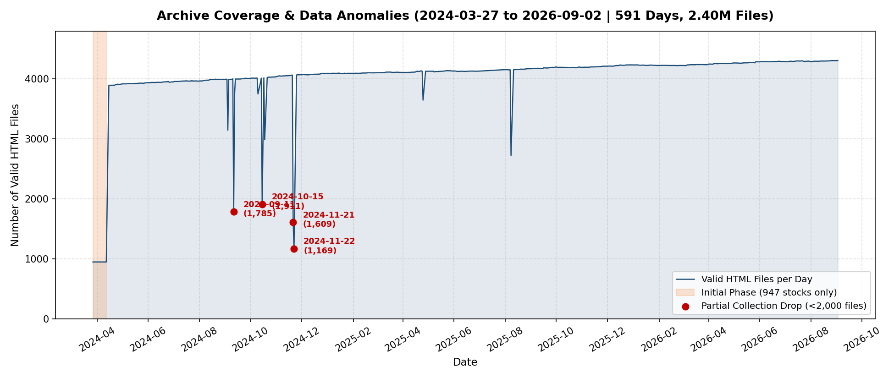
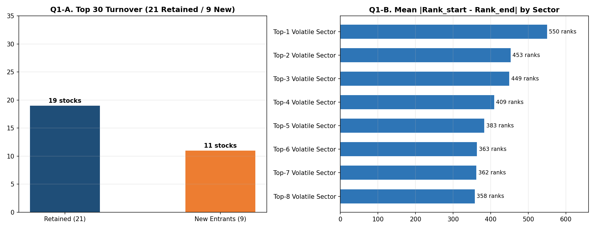
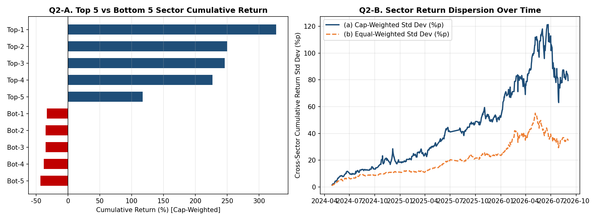
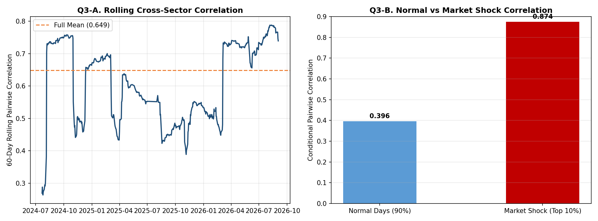
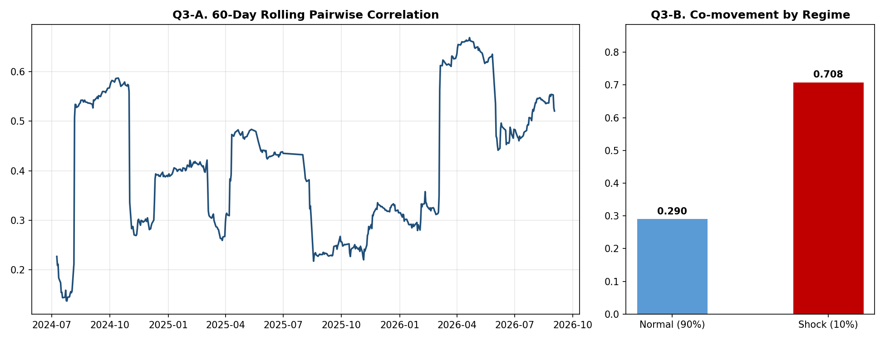
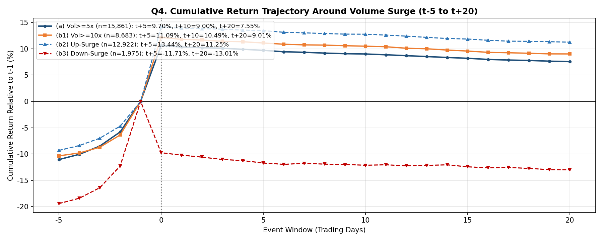
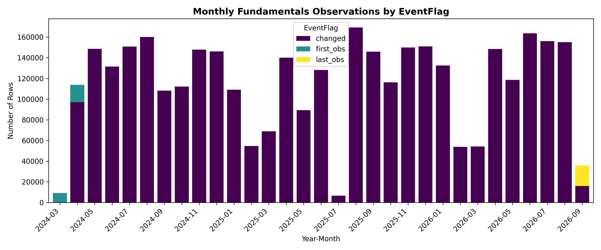
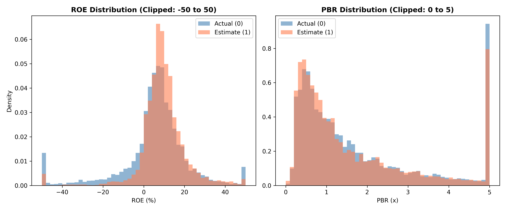

# 금융통계 기말 프로젝트 (2026-2) · 1차 발표

> 네이버 증권 종목 페이지 일별 아카이브(2024-03-27 ~ 2026-09-02)를 전수 파싱해
> **시가총액 순위 · 업종 수익률 격차 · 업종 간 동조화 · 거래량과 가격의 선후관계**를 분석한다.
>
> - 1차 발표: 전체 종목 데이터 정제 + 공통 질문 4개 + 재무제표 질문 5개
> - 2차 발표: 전자장비와기기(PCB) 업종 심층 분석 및 산업·종목 보고서 비교

`⬜`는 아직 채우지 못한 항목이다.

## 목차
1. [자료를 읽어 들였다는 증거](#1-자료를-읽어-들였다는-증거)
2. [자료의 결함과 처리](#2-자료의-결함과-처리)
3. [공통 질문 Q1~Q4](#3-공통-질문-q1q4)
4. [재무제표 질문 Q5~Q9](#4-재무제표-질문-q5q9)
5. [정의를 바꾸면 결론이 바뀌는 경우 (요약)](#5-정의를-바꾸면-결론이-바뀌는-경우-요약)
6. [재현 방법](#6-재현-방법)
7. [저장소 구조](#7-저장소-구조)

---

## 1. 자료를 읽어 들였다는 증거

| 항목 | 값 | 출처 |
|---|---|---|
| 원자료 | `<날짜>/<종목코드>.html` (네이버 증권 종목 페이지) | 교수님 제공 아카이브 (저장소에는 없음) |
| 기간 | **2024-03-27 ~ 2026-09-02** | `01_scan_archive.py` |
| 날짜 폴더 수 | **591일** | 〃 |
| HTML 파일 수 | **2,403,074개** | 〃 |
| 고유 종목코드 | **5,760개** (ETF/ETN 1,923 · 스팩 149 · 우선주 232 포함) | `02_parse_all.py` |
| 하루 유효 파일 수 | 약 3,900 → 4,300개로 완만히 증가 (아래 그림) | `01_plot_coverage.py` |
| 파싱 후 시세 행 수 · 분석 대상 종목 수 | ⬜ `02_parse_all.py` / `04_common_questions.py` 실행 로그 값 기입 | |
| 재무 표(기업실적분석) | 보유 종목 **3,837개**, 변경 스냅샷 **363,336건** | `02b_parse_financials.py` |
| 재무 표 변경 이벤트 추출 (신규) | `fundamentals_events.csv` (건수 ⬜) | `extract_fundamentals.py` |



### 읽지 못한 부분

| 구분 | 규모 | 내용 |
|---|---|---|
| 폴더 자체가 없는 평일 | **45일** | 공휴일과 수집 누락이 섞여 있음. 2025-07-02~07-31(평일 22일 연속)은 공휴일일 수 없으므로 수집 누락 |
| 종목 수가 적은 초기 구간 | 947종목만 수집 | 2024-03-27, 2024-04-04 ~ 04-12 |
| 수집 급감일 (<2,000개) | 4일 | 2024-09-11 (1,785), 2024-10-15 (1,911), 2024-11-21 (1,609), 2024-11-22 (1,169) |
| 손상 파일 | 1건 | `2026-03-04/252670.html` (2,916B, 네이버 메인 리다이렉트) |
| 10KB 미만·태그 없음 등 파싱 제외 | ⬜ | `logs/parse_error_log.csv` 건수 기입 |

<details>
<summary>폴더가 없는 평일 45일</summary>

2024-03-28, 03-29, 04-01, 04-02, 04-03, 07-19, 09-02, 10-11, 10-16 /
2025-05-13, 05-14, 05-15, 05-16, 05-20, 05-21, 05-22, 05-26 /
2025-07-02 ~ 07-31 (22일), 08-15, 10-08, 10-09, 10-10 /
2026-05-28, 05-29

</details>

---

## 2. 자료의 결함과 처리

| 결함 | 규모 | 처리 | 남는 한계 |
|---|---|---|---|
| 초기 불완전 수집 | 947종목 구간 | 전 종목 수집이 시작된 **2024-04-15 ~ 2026-09-02(582거래일)** 를 분석 기간으로 | 분석 기간이 약 2.4년이라 "2년 반"보다 짧다 |
| ETF·ETN·스팩·우선주 | 비보통주 2,304개 | 제외. 업종명이 있고, 스팩(`스팩`, `제N호`)이 아니며, 코드 끝자리가 0인 **보통주만** 사용 | 코드 끝자리 규칙으로 우선주를 거른다 |
| 가격 불연속 (액면분할·병합·감자) | 652종목 914건 (일 변동 ±30.5% 초과) | 해당 날 수익률을 **제외(결측→0 처리)** | 실제 급등락도 함께 제외될 수 있다 |
| 업종 재분류 | 220종목 | **종료일(2026-09-02) 업종으로 통일** | 과거 시점 업종이 당시 분류와 다를 수 있다 |
| 휴장·수집 누락일 | 평일 45일 | 존재하는 직전 거래일 대비로 수익률 계산 | 누락 다음 날은 여러 날치 변동이 합쳐진다. 60일·20일 창은 달력이 아니라 행 수 기준 |
| 수집 급감일 | 4일 | 별도 제외 없음 | 그날은 업종 구성 종목 수가 적다 |
| 손상 HTML | 1건 | 10KB 미만 파일 자동 제외 | |
| 배당 미반영 | 종가만 존재 | 가격수익률로 분석 | 금융·통신 등 고배당 업종의 총수익률이 과소평가 |

---

## 3. 공통 질문 Q1~Q4

공통 정의: 분석 기간 2024-04-15 ~ 2026-09-02, 유니버스 = 업종명이 있는 보통주, 시가총액 = 네이버 페이지의 시가총액(억원), 일별 수익률 = 종가 기준 단순수익률(±30.5% 초과일 제외), 업종 = 네이버 증권 업종명(종료일 기준).

### Q1. 시가총액 순위는 2년 반 동안 얼마나 바뀌었는가

**정의**
- 비교 시점: 시작일 2024-04-15 vs 종료일 2026-09-02, 각 시점 전체 시장 시가총액 순위
- 업종별 순위 이동 크기: **(a) 평균 |시작순위 − 종료순위|(기본)**, (b) 평균 |시작순위 − 종료순위| / 시작순위
- 제외: 양 시점 모두 존재하지 않는 종목(순위 이동 계산에서만), 비보통주, 15종목 미만 업종

| 세부 항목 | 결과 |
|---|---|
| 2년 반 전 상위 30위 중 지금도 30위 안인 종목 수 | **19개 / 30개** |
| 새로 들어온 종목과 그 업종 | **11개** 신규 진입. 확인된 종목: 한화에어로스페이스(우주항공과국방), 두산에너빌리티(기계), HD현대중공업·한화오션(조선), LS ELECTRIC·HD현대일렉트릭·효성중공업(전기장비), 고려아연(비철금속), 우리금융지주(은행). 나머지 2개 ⬜ |
| 업종별 순위 이동의 크기 | (a) 기준 1위 **생명과학도구및서비스 평균 550위 이동**, 이어서 약 453·449·409·383위 (업종명 ⬜) |



> 그림 왼쪽 제목의 "21 / 9"는 이전 버전에서 하드코딩된 라벨이고, 막대의 값 19 / 11이 계산값이다.

**한 문장 결론:** 2년 반 전 상위 30위 중 19개만 남고 11개가 교체되었으며, 교체는 방산·원전·조선·전력기기 업종이 주도했다.

### Q2. 업종 간 수익률의 차이는 2년 반 동안 벌어졌는가, 좁혀졌는가

**정의**
- 업종 일별 수익률: **(a) 전일 시가총액 가중 평균(기본)**, (b) 동일 가중 평균
- 업종 누적 수익률: 일별 업종 수익률의 복리 연쇄곱 (1+r₁)(1+r₂)…(1+rₜ) − 1
- 업종 간 분산: 날짜별 **업종 누적 수익률의 횡단면 표준편차(%p)**
- 제외: 10종목 미만 업종, ±30.5% 초과일, 분석 시작 직후 9거래일

| 세부 항목 | 결과 |
|---|---|
| 업종별 누적 수익률 | 상위 5개 약 +120% ~ +330%, 하위 5개 약 −33% ~ −43% (그림 왼쪽에서 읽은 근사값) |
| 업종 간 분산의 시간 변화 | 시총가중 **1.4%p → 79.5%p** (2026년 5월경 약 120%p 정점 후 하락). 동일가중은 종료 시점 **34.6%p** |
| 차이를 만든 상위 업종 | 반도체와반도체장비 · 전기장비 · 우주항공과국방 · 전자장비와기기 · 조선 (수치 ⬜ 재실행 후 확정) |



**한 문장 결론:** 업종 간 수익률 격차는 2년 반 동안 크게 벌어졌고(표준편차 1.4%p → 79.5%p), 시총가중이 동일가중(34.6%p)보다 두 배 이상 커서 대형 주도주가 확대를 이끌었다.

### Q3. 업종들은 같이 움직이는가, 따로 움직이는가

**정의**
- 업종 일별 수익률: **(a) 업종 내 종목 단순평균(EW, 기본)**, (b) 전일 시가총액 가중(VW)
- 상관: 10종목 이상 업종 쌍의 일별 수익률 피어슨 상관을 모든 쌍에 대해 평균
- 시간 변화: 60거래일 이동 창 평균 상관
- 시장이 크게 흔들린 날: 시장 수익률의 **|값| 상위 10%**, 보통 날은 나머지 90%
- 제외: 10종목 미만 업종, ±30.5% 초과일, 비보통주

| 세부 항목 | 결과 (EW) | VW로 바꾸면 |
|---|---|---|
| 업종 간 일별 수익률 상관 (전체 평균) | **0.649** | ⬜ |
| 상관의 시간 변화 (60일) | 약 0.26 ~ 0.79 사이를 오감. 최고 2026년 7월경, 최저 2025년 11월경 | 그림 아래 |
| 보통 날 | **0.396** | 0.290 |
| 시장이 크게 흔들린 날 | **0.874** (보통 날의 2.2배) | 0.708 (2.4배) |





> 60일 이동 상관이 하루 사이 0.2~0.3씩 꺾이는 구간(2024-08, 2024-11, 2026-03 부근)이 있다. 극단 수익률 하루가 창에 들어오고 나갈 때 생기는 모양으로 보이며, 원인은 ⬜ 확인 필요.

**한 문장 결론:** 업종들은 평소에는 따로 움직이지만(상관 0.396), 시장이 크게 흔들리는 날에는 일제히 같이 움직인다(0.874).

### Q4. 거래량은 가격을 앞서는가, 뒤따르는가

**정의**
- 거래량 급증(기본): **당일 거래대금 100억 원 이상 & 당일 거래량 ≥ 직전 20일 평균의 5배** (평균은 최소 15일 이상 있어야 계산)
- 대안: 10배 이상 / 5배 이상이면서 당일 상승 / 5배 이상이면서 당일 하락
- 수익률: 이벤트별 일별 수익률을 평균해 복리 누적, t−1 종가를 0%로 정렬
- 제외: 거래대금 100억 미만, ±30.5% 초과일, 상장 15일 미만

| 세부 항목 | 결과 |
|---|---|
| 거래량 급증의 정의 | 위 정의. 사건 수 **15,861건** |
| 급증 당일 | **+10.58%** (t−1 대비) |
| 급증 뒤 5·10·20일 | t−1 대비 누적 +9.70% / +9.00% / +7.55%. **급증 당일 종가 대비로는 −0.80% / −1.43% / −2.74%** |
| 급증 직전 | 그림에서 t−5가 약 −11%이므로, 직전 4거래일에 이미 약 +11% 올라 있었다 |
| 정의를 바꾸면 | 10배(8,683건)·상승 급증(12,922건)도 같은 모양. 하락 급증(1,975건)은 당일 약 −10% 이후에도 계속 약 3%p 더 하락 |



**한 문장 결론:** 거래량 급증은 가격 상승을 앞서기보다 이미 오른 가격과 함께 나타나고, 이후 5·10·20일 동안 소폭 되돌림이 뒤따른다.

---

## 4. 재무제표 질문 Q5~Q9

종목 페이지의 **기업실적분석 표**(매출액·영업이익·영업이익률·ROE·부채비율·EPS·BPS·배당, 추정치 `E` 포함)를 쓴다.
이 표는 날마다 바뀌지 않지만 날마다 저장했으므로, **표가 바뀐 날이 곧 실적 발표일**이다. 그래서 날짜별로 표를 비교해 바뀐 날을 찾는 작업이 모든 질문보다 먼저다.

### 4-1. 실적 표 추출 (오늘 추가)

| 항목 | 내용 |
|---|---|
| 스크립트 | `extract_fundamentals.py` (저장소 루트) |
| 입력 | `/mnt/data/stock/<날짜>/<종목코드>.html` 전체 (표 클래스 `tb_type1_ifrs`) |
| 추출 지표 | 매출액, 영업이익, 당기순이익, 영업이익률, 순이익률, ROE(지배주주), 부채비율, EPS, PER, BPS, PBR, 주당배당금, 시가배당률, 배당성향 (14개) |
| 기간 구분 | `PeriodType` = Y(연간) / Q(분기), `FiscalPeriod` = 결산 기준월, `IsEstimate` = 1이면 추정치(E) |
| 바뀐 날 찾는 방식 | 종목별로 표 전체(모든 기간·지표 값)를 이전 저장분과 비교한다. 처음 보이면 `first_obs`, 값이 하나라도 달라졌으면 `changed`, 마지막 관측일은 `last_obs` 로 표시하고, 이 세 경우만 행으로 남긴다 |
| 출력 | `~/fundamentals_events.csv` (`.gitignore`로 저장소에는 없음) |

| 그림 | 만드는 스크립트 | 내용 |
|---|---|---|
| `events_timeline.png` | `plot_fundamentals.py` | 월별 저장 행 수를 EventFlag별로 쌓은 막대 |
| `fundamentals_summary.png` | `plot_fundamentals.py` | 실적치(Actual) vs 추정치(Estimate)의 ROE·PBR 분포 |



그림에서 읽은 것:
- 2024-03~04의 `first_obs`는 수집 초기(947종목) 구간에서 처음 관측된 종목이고, 2026-09의 `last_obs`는 마지막 날 기준 최종 표다. 그 외 달은 거의 전부 `changed`다.
- 월별 행 수는 대체로 10만~17만 행인데 **2025-07만 약 7천 행**으로 급감한다. 2025-07-02~07-31 폴더 누락(§1)과 일치하므로 수집 누락의 영향으로 보인다.
- 2025-03, 2025-04, 2026-02~03도 상대적으로 낮다. 원인은 ⬜ 확인 필요.



그림에서 읽은 것 (분포 모양을 눈으로 읽은 값, 계산값은 아님):
- ROE: 실적치는 음수 쪽 꼬리가 두껍고(−50% 이하로 잘린 막대 포함), 추정치는 0~20% 구간에 몰려 있다. 추정치에는 큰 적자 예상이 거의 없다.
- PBR: 두 분포 모두 0.3~1.0 구간에 가장 많이 몰려 있어 **PBR 1 미만 종목이 많다**(Q9 재료). 5배 이상은 5로 잘려 맨 오른쪽에 쌓여 있다.

> **주의 (바뀐 날 ≠ 실적 발표일일 수 있다):** 바뀐 날 판정이 표 전체 비교라서, 추정치(E)만 수정되어도 `changed`가 된다. 월 10만 행 이상이 `changed`인 것도 이 때문으로 보인다. 실적 발표일로 쓰려면 **`IsEstimate`가 1에서 0으로 바뀐 기간**(추정치가 실적치로 확정된 날)만 골라내는 단계가 더 필요하다. ⬜
>
> **수치 불일치:** 위 §1의 "3,837종목, 변경 스냅샷 363,336건"은 `02b_parse_financials.py` 결과이고, 오늘 `extract_fundamentals.py`가 만든 CSV는 기간별 행 단위(종목 × 기간)라 건수 단위가 다르다. `plot_fundamentals.py` 주석에는 약 357만 행으로 적혀 있으나, 이 README에서 CSV를 직접 세어 확인한 값은 아니다. ⬜ 실행 로그로 확정

### 4-2. 질문별 결과

아직 분석 스크립트와 결과는 없다. 질문과 확인할 항목만 적어 둔다 (정의·그림·결론은 분석 후 기입).

| 질문 | 확인할 항목 | 정의 | 그림 | 한 문장 결론 |
|---|---|---|---|---|
| **Q5** 영업이익률이 높은 업종이 주가 수익률도 높았는가 | 업종별 영업이익률과 누적 수익률의 관계 / 업종 안에서도 같은 방향인가 / 이익률이 *올라간* 업종과 *원래 높았던* 업종 중 어느 쪽이 올랐는가 | ⬜ | ⬜ | ⬜ |
| **Q6** 실적 발표 뒤 주가는 며칠 만에 반응을 끝내는가 | 실적 표가 바뀐 날 찾기 / 발표 전후 10일 누적 수익률 / 영업이익이 추정치를 넘긴 경우와 못 미친 경우의 차이 | ⬜ | ⬜ | ⬜ |
| **Q7** 추정치는 어느 업종에서 가장 많이 빗나갔는가 | 업종별 추정 오차 분포 / 같은 분기 추정치가 발표 전 몇 달 동안 어떻게 수정됐는가 / 빗나간 방향이 한쪽으로 쏠리는가 | ⬜ | ⬜ | ⬜ |
| **Q8** 부채비율이 높은 업종이 더 크게 흔들렸는가 | 부채비율과 수익률 변동성의 관계 / 시장이 급락한 구간과 보통 구간의 비교 | ⬜ | ⬜ | ⬜ |
| **Q9** PBR이 1 아래인 종목은 2년 반 뒤 어떻게 됐는가 | 저PBR 종목이 몰린 업종 / ROE가 양수인 종목과 음수인 종목의 이후 수익률 차이 / 저PBR이 해소된 종목과 그대로인 종목 | ⬜ | ⬜ | ⬜ |

> Q9의 "2년 반"은 분석 기간(2024-04-15 ~ 2026-09-02, 약 2.4년)과 맞춘 것이다. Q6·Q7은 먼저 "표가 바뀐 날(실적 발표일)" 목록이 있어야 한다.

---

## 5. 정의를 바꾸면 결론이 바뀌는 경우 (요약)

| 질문 | 바꾼 정의 | 바뀌는 결론 |
|---|---|---|
| Q1 | 순위 이동 (a) 절대 순위 차이 → (b) 상대 변화율 | 이동이 가장 큰 업종이 생명과학도구및서비스(550위)에서 **양방향미디어와서비스(69.8%)** 로 바뀐다 |
| Q2 | 업종 가중 (a) 시총가중 → (b) 동일가중 | 격차 확대 방향은 같지만 크기가 79.5%p → 34.6%p로 **절반 이하** |
| Q3 | 전체 평균 → 급변동일/보통 날 분리 | 전체 평균 0.649만 보면 중간 정도의 동조화지만, 분리하면 **평소 0.396 / 급변동일 0.874** |
| Q3 | 업종 수익률 EW → VW | 방향은 같고 수준이 0.396→0.290, 0.874→0.708로 낮아진다 |
| Q4 | 급증 정의 → 하락 급증만 | 상승 급증은 소폭 되돌림, **하락 급증은 되돌림 없이 추가 하락** |

---

## 6. 재현 방법

### 환경
```bash
python -m venv venv && source venv/bin/activate     # Windows: venv\Scripts\activate
pip install -r requirements.txt
```
- 모든 스크립트는 **저장소 루트에서** `python src/<파일>.py` 로 실행한다 (`outputs/`, `data_processed/`, `logs/` 상대경로 사용).
- 원자료 경로가 `/mnt/data/stock`(`BASE_DIR`)으로 고정되어 있다. 자료를 다른 곳에 두었다면 심볼릭 링크를 만들거나 `BASE_DIR`을 고친다.
- 파싱 스크립트는 `ProcessPoolExecutor(max_workers=64)`를 쓴다. 코어가 적으면 `max_workers`를 줄인다.
- 원자료와 중간 산출물(`*.pkl`, `*.csv`)은 `.gitignore`로 제외되어 저장소에 없다.

### 실행 순서
```bash
# 0. 자료 점검
python src/01_scan_archive.py       # → outputs/archive_scan_summary.csv
python src/01_plot_coverage.py      # → outputs/week1_archive_coverage.png

# 1. 파싱
python src/02_parse_all.py          # → data_processed/daily_market.pkl, financial_snapshots.pkl
python src/02c_fix_tab1.py          # 시가총액·주식수·PER·PBR 재파싱 (pkl 갱신)
python src/02d_fix_sector.py        # 업종명 재추출 (pkl 갱신)
python src/02b_parse_financials.py  # 기업실적분석 표 스냅샷
python src/03_diagnose_defects.py   # 결함 진단 (콘솔 출력)

# 2. 정제 + 공통 질문
python src/run_q12.py               # → data_processed/clean_q.pkl (정제 데이터)
python src/run_q1.py                # → outputs/q1_def.png, meta.json (가장 먼저)
python src/run_q2.py                # → outputs/q2_def.png
python src/run_q3.py                # → outputs/q3_def.png
python src/run_q4.py                # → outputs/q4_def.png
python src/run_q23.py               # → outputs/q3_sector_correlation.png (VW)
python src/fix_q12_full.py          # → outputs/q1_mcap_rank_shift.png (맨 마지막)

# 3. 재무제표 (루트에서 실행)
python extract_fundamentals.py      # → ~/fundamentals_events.csv (실적 표가 바뀐 날만 저장)
python plot_fundamentals.py         # → events_timeline.png, fundamentals_summary.png

# 4. 보고서 HTML
python src/build_html.py            # → week2_submission.html
```
> `plot_fundamentals.py`는 CSV를 `/home/s202325492/fundamentals_events.csv` 로 **고정 경로**에서 읽고, 그림은 현재 폴더에 저장한다. 다른 환경에서는 경로를 고쳐야 하고, `extract_fundamentals.py`는 `max_workers=8`이다.
>
> `run_q1.py`가 `outputs/meta.json`을 새로 만들고 이후 스크립트가 값을 덧붙이므로 순서를 지켜야 한다.

---

## 7. 저장소 구조

```
.
├── README.md
├── requirements.txt
├── week1_submission.md          # 1주차 제출: 아카이브 범위·결함 스캔
├── week2_common_questions.md    # 2주차 초기 메모 (수치는 아래 HTML이 최신)
├── week2_submission.html        # 2주차 면담 보고서
├── extract_fundamentals.py      # 실적 표 변경 이벤트 추출 (재무제표 질문용)
├── plot_fundamentals.py         # 위 결과 요약 그림 2장
├── events_timeline.png
├── fundamentals_summary.png
├── outputs/                     # 그림(png)과 meta.json
└── src/
```

| 구분 | 파일 | 역할 |
|---|---|---|
| 점검 | `01_scan_archive.py`, `01_plot_coverage.py` | 날짜별 파일 수·결함 스캔, 커버리지 그림 |
| 파싱 | `02_parse_all.py`, `02c_fix_tab1.py`, `02d_fix_sector.py`, `02b_parse_financials.py` | HTML → 시세·시가총액·업종·재무 표 |
| 진단 | `03_diagnose_defects.py` | 업종 결측, 특수 종목, 재분류, 가격 불연속 |
| 정제 | `run_q12.py` | 보통주 필터, 수익률 계산 → `clean_q.pkl` |
| 재무 | `extract_fundamentals.py`, `plot_fundamentals.py` | 기업실적분석 표 변경 이벤트 추출, 월별 분포·실적/추정 분포 그림 |
| Q1~Q4 | `run_q1.py` ~ `run_q4.py`, `run_q23.py`, `fix_q12_full.py` | 질문별 분석·그림 |
| 보고서 | `build_html.py` | `week2_submission.html` 생성 |
| Q1·Q2 그림 수정본 | `one.py` | `fix_q12_full.py`의 수정본 (하드코딩 라벨 제거, 요약 txt 생성). `src/`로 옮겨 쓰는 용도 |
| 독립 실행판 | `04_common_questions.py` | 파싱 결과에서 Q1~Q4를 한 번에 계산 (업종 15종목 이상, 필터가 달라 수치가 최종과 다름) |
| 구버전·중복 | `generate_all_charts.py`, `step1_q12.py`, `step2_q34_html.py`, `build_clean.py`, `build_clean_html.py`, `build_full_html.py`, `build_week2_html.py`, `make_html.py`, `patch_html_details.py` | 이전 시도 |
